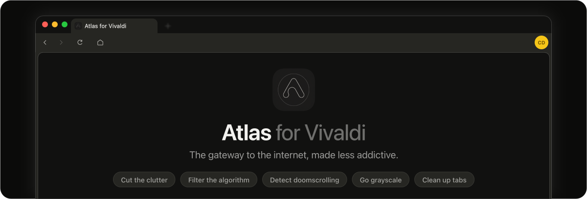

<p align="center">
  <picture>
    <source media="(prefers-color-scheme: dark)" srcset="assets/banner-light.svg">
    
  </picture>
</p>

<p align="center">
  <b>A calmer <a href="https://vivaldi.com/">Vivaldi</a>: restyled from the tab bar to the new tab, with Focus tools that make the web less addictive.</b>
</p>

<p align="center">
  
  
  
  
  
  
  
</p>

> [!IMPORTANT]
> Atlas **changes Vivaldi's own files on your computer**: it adds its code to Vivaldi's window, turns off Vivaldi's auto-updates and, on macOS, re-signs the app. Vivaldi replaces those files when it updates, so re-run the installer after a Vivaldi update. Atlas is an independent project and is **not affiliated with or endorsed by** Vivaldi Technologies.

> [!WARNING]
> Atlas is a private beta built around my own setup, and it keeps changing. The installer backs up your profile's `Preferences` before every write, but run it with `--dry-run` first to see every change it would make.

---

Atlas restyles Vivaldi and replaces its new tab with the **Detractless** dashboard. On top of that sit the Focus tools: ways to make the browser work for your attention instead of against it. Most of them can be locked, so a weak moment can't undo a good decision.

---

## Features

<table>
<tr>
  <td width="190"><b>Restyled Vivaldi</b><br><sub><code>available now</code></sub></td>
  <td>A quieter look for the whole window: tabs, address bar, toolbar, menus, sidebar, popups and the extensions menu, plus a page right-click menu trimmed down to what gets used.</td>
</tr>
<tr>
  <td><b>Detractless new tab</b><br><sub><code>available now</code></sub></td>
  <td>Replaces Vivaldi's start page with a dashboard of your pages, bookmarks and profiles. Each profile can open Google links as its own Google account.</td>
</tr>
<tr>
  <td><b>Scroll fade</b><br><sub><code>available now</code></sub></td>
  <td>Every page gets darker the longer or farther you scroll, on all sites together, so hopping to another site doesn't start you over. Once it is fully dark it stays that way for a wait you can't shorten by scrolling or by stopping (10 minutes by default). It is drawn by Vivaldi's own window, so it dims every page, even ones no script can run on.</td>
</tr>
<tr>
  <td><b>Doomscroll detection</b><br><sub><code>coming soon</code></sub></td>
  <td>Spot the moment you slip into endless scrolling and step in. Today, Scroll fade covers this by dimming every page the longer or farther you scroll; detection is the smarter version planned on top of it.</td>
</tr>
<tr>
  <td><b>Social media filter</b><br><sub><code>available now</code></sub></td>
  <td>Hide the parts of YouTube, Reddit, Instagram, X, TikTok, Facebook, Snapchat and Twitch that pull you in, or block a whole site.</td>
</tr>
<tr>
  <td><b>Content shield</b><br><sub><code>available now</code></sub></td>
  <td>A model that runs on your computer checks images and blurs or blacks out the ones you'd rather not see. See the note under <a href="#getting-started">Getting started</a>: its model files are not in this repository yet.</td>
</tr>
<tr>
  <td><b>Colour level</b><br><sub><code>available now</code></sub></td>
  <td>A slider from full colour to grayscale. Vivaldi's window draws it, so pages never flash in colour while they load. Atlas's own pages stay in colour.</td>
</tr>
<tr>
  <td><b>Tab limiter and search delay</b><br><sub><code>available now</code></sub></td>
  <td>Cap how many tabs can be open, and put a pause in front of searches.</td>
</tr>
<tr>
  <td><b>Tab cleanup</b><br><sub><code>coming soon</code></sub></td>
  <td>Tidy your tabs for you. Today, the tab limiter caps how many tabs can be open, by blocking the new tab or closing a random one.</td>
</tr>
<tr>
  <td><b>Focus locks</b><br><sub><code>available now</code></sub></td>
  <td>Lock a Focus setting and it can only get <i>stricter</i>. Unlocking takes 30 minutes, so loosening one is a decision, not an impulse.</td>
</tr>
<tr>
  <td><b>Usage</b><br><sub><code>available now</code></sub></td>
  <td>Settings &gt; Usage shows where your time and scrolling go, site by site. The numbers are kept on your computer.</td>
</tr>
<tr>
  <td><b>Writing help</b><br><sub><code>available now</code></sub></td>
  <td>Spell checking, and the <a href="https://writewithharper.com/">Harper</a> grammar checker as an offline extension.</td>
</tr>
<tr>
  <td><b>Pattern control</b><br><sub><code>idea, not built</code></sub></td>
  <td>Notice sites that match your own distraction pattern and suggest blocking them. It suggests; it never blocks on its own.</td>
</tr>
</table>

Each feature has its plan in [`docs/specs/`](docs/specs/).

---

## Getting started

> **Status:** Atlas installs from source. There is no prebuilt installer to download yet.

> [!NOTE]
> The content shield's model files (about 265 MB) are not in this repository yet, so the shield won't work from a fresh copy. Everything else does.

### Prerequisites

- **macOS** with [Vivaldi](https://vivaldi.com/) installed. Atlas is built and tested on macOS; the installer has a Windows path (`py -3 install.py`) that isn't regularly tested.
- **Python 3.** The installer uses only the standard library.
- **Node.js**, only to build the new-tab bundles or run the tests.

### Install

```bash
git clone https://github.com/Detractless/Atlas-for-Vivaldi.git
cd Atlas-for-Vivaldi

python3 install.py --dry-run   # print every change, touch nothing
python3 install.py             # the real install
```

A running Vivaldi is left alone: it keeps its old files until you quit and relaunch it. Flags: `--close` quits Vivaldi first, `--launch` reopens it afterwards, `--skip-detractless` leaves out the new tab, `--dry-run` changes nothing.

Vivaldi replaces its program folder on every update, so re-run the installer after one. The CSS mods and the `Preferences` edits survive updates.

<details>
<summary><b>What the installer does</b></summary>

1. Copies the Atlas files and the page-menu content scripts into Vivaldi's `resources/vivaldi`.
2. Adds `atlas.js` (and `profilesCore.js`) to `window.html`.
3. Installs the Detractless new tab: only the files its pages load.
4. Copies `css-mods` to `Vivaldi/Atlas/css-mods`.
5. Prunes Vivaldi's page context menus.
6. Edits `Default/Preferences`: CSS-mods folder, toolbar layout, new-tab page, Atlas themes. Stops without writing if `Preferences` can't be read, and backs it up before every write.
7. Registers the Harper extension.
8. Turns off Vivaldi auto-updates.
9. macOS: re-signs the app ad hoc, and stops if signing fails.

</details>

### Build and test

```bash
npm install        # once: esbuild, jsdom and the other dev tools
./build.sh         # macOS: dist/AtlasSetup.dmg (Windows: build.cmd -> dist\AtlasSetup.exe)
npm test           # node and Python unit tests
```

`build.sh` runs `scripts/build.py`: it joins `src/modules` into `atlas.js`, builds the new-tab bundles, then packages for the platform. The tests load the real new tab, browser-window code, page menu and service worker in jsdom with stand-in `chrome.*` APIs, so nothing touches Vivaldi. Size, line-ending and storage-key rules are tests too.

---

## How it fits together

Atlas is a set of parts that run in different places. The installer copies them into Vivaldi; nothing runs as a separate program.

| Part | Where it lives | Role |
|---|---|---|
| **Window code** | `src/modules/NN-*.js`, joined into `payload/install-files/atlas.js` | Runs inside Vivaldi's own window: menus, address bar, toolbar, the colour filter and the Scroll fade layer. |
| **Page scripts** | `payload/install-files/components/atlas/atlas-*.js` | Run on web pages: the right-click menu, usage and scroll counting, the social filter and the content shield. |
| **Detractless** | `payload/detractless/` | The new-tab extension: dashboard, Settings, profiles and the background service worker. `npm run build` writes `src/dist/`; never edit `dist` by hand. |
| **Restyling** | `payload/css-mods/` | The CSS that restyles Vivaldi's window. |
| **Harper** | `payload/extensions/harper/` | The offline grammar-checker extension. |
| **Installer** | `install.py`, `installer/` | Copies it all into Vivaldi, one module per step. |

<details>
<summary><b>Where things are</b></summary>

| Path | What it is |
|---|---|
| `payload/detractless/src/constants/atlasKeys.json` | The one list of storage keys, defaults, database names and the extension id. |
| `payload/detractless/src/settings/` | The settings registry (every setting saves at once and syncs across tabs) and the Settings pages. |
| `payload/detractless/src/utils/` | The rules the Focus tools share: the lock, the social filter, Scroll fade. |
| `payload/detractless/src/components/addPopup/` | The + button's popup: add a bookmark or a page, or edit a page. |
| `payload/detractless/src/pages/newtab/profile*.js` | Profiles: shared state, Settings > Profiles, and each profile's edit page with its Google account. |
| `docs/specs/` | Feature plans, design notes and what was measured. |
| `tests/unit/` | All tests. |
| `_old/` | Archived features, retired tests and old notes, each with a README or RESTORE.md. |

</details>

---

## Project status & roadmap

- [x] Restyled window and the Detractless new tab
- [x] Focus tools: colour level, tab limiter, search delay, content shield, social filter, Scroll fade
- [x] Focus locks with a 30 minute unlock
- [x] Usage page
- [x] macOS installer
- [ ] Content shield model files for fresh copies
- [ ] Doomscroll detection, beyond Scroll fade
- [ ] Tab cleanup, beyond the tab limit
- [ ] A richer Usage page
- [ ] Pattern control
- [ ] Regular Windows testing
- [ ] Licence and credits, before this goes public

---

## License

No licence has been chosen yet, so all rights are reserved for now.

---

<p align="center">
  <sub>Atlas is an independent project and is not affiliated with or endorsed by Vivaldi Technologies.</sub>
</p>
